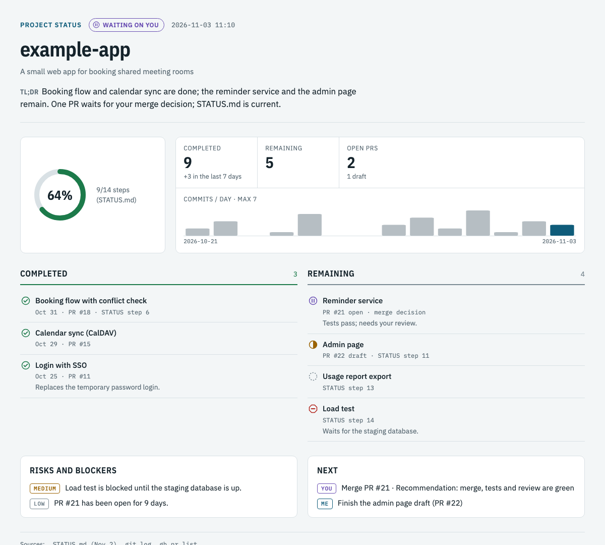

# claude-skills

Two [Claude Code](https://claude.com/claude-code) skills that report on work in progress as a visual Artifact page and a short
chat summary. Both are read-only; side-sessions archives finished sessions only after you approve.

| Skill | What it does |
|---|---|
| [`project-status`](skills/project-status/SKILL.md) | Builds a project's status from STATUS.md / ROADMAP.md, git log, GitHub PRs, [delix](https://github.com/tahircengiz/delixcrew) `STATE.json` and an optional Ortak task board: completed and remaining work, open PRs, risks, next steps. |
| [`side-sessions`](skills/side-sessions/SKILL.md) | Checks the side sessions started from the current session, verifies each one's branch, push and PR state with git/gh, and sorts them into Done, Waiting on you, In progress, Blocked or Attention. Passes results to the parent session and archives finished sessions if you approve. |



## Requirements

- Claude Code 2.1 or later; the skills use `${CLAUDE_SKILL_DIR}` to find their scripts.
- Python 3 and git. `gh` (signed in) is optional and adds PR data.
- The Artifact tool, which publishes the page to claude.ai. Without it the skills still write the HTML file to the
  session's scratchpad.
- side-sessions only: the Claude desktop app (Code tab). It needs the app's session tools, which the CLI doesn't have.

## Installation

Clone the repo and link both skills into your personal skills folder:

```bash
git clone https://github.com/tahircengiz/claude-skills.git ~/claude-skills
```

```bash
mkdir -p ~/.claude/skills && ln -s ~/claude-skills/skills/project-status ~/.claude/skills/project-status && ln -s ~/claude-skills/skills/side-sessions ~/.claude/skills/side-sessions
```

Install both even if you only want side-sessions, because it renders its page with project-status's `render.py`. To
install them for one project instead, put them in that project's `.claude/skills/` folder. Updating is `git pull` in
the clone.

## Usage

- `/project-status` (or "what's the project status?") reports on the current directory. `/project-status <path>`
  reports on another project.
- `/side-sessions` (or "how are the side sessions doing?") checks the side sessions started from this session.
  `/side-sessions --no-page` writes only the chat report. Inside a side session, the same command sends that
  session's closing report to its parent.

Each project and each parent session keeps a single Artifact URL; later runs update the same page.

## How it works

```
skills/
├── project-status/
│   ├── SKILL.md            instructions and data schema
│   ├── scripts/collect.py  read-only raw data: git, status file, delix state, PRs
│   ├── scripts/render.py   validates the data JSON and fills the template
│   └── assets/page.html    fixed page design (light/dark, phone width)
└── side-sessions/
    ├── SKILL.md
    └── scripts/check.py    read-only loss-risk check of a worktree: dirty files, unpushed commits, PR
```

Claude fills in the data and the template keeps the design the same from run to run. Every item on the page comes
from a source listed in its footer, and the progress percentage comes only from a countable step or task list, never
from commit counts.

## License

MIT, see [LICENSE](LICENSE).
